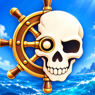
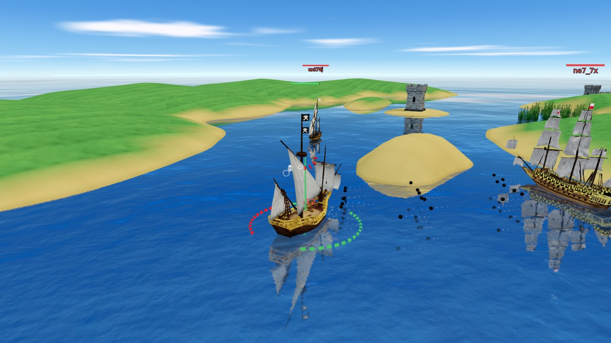
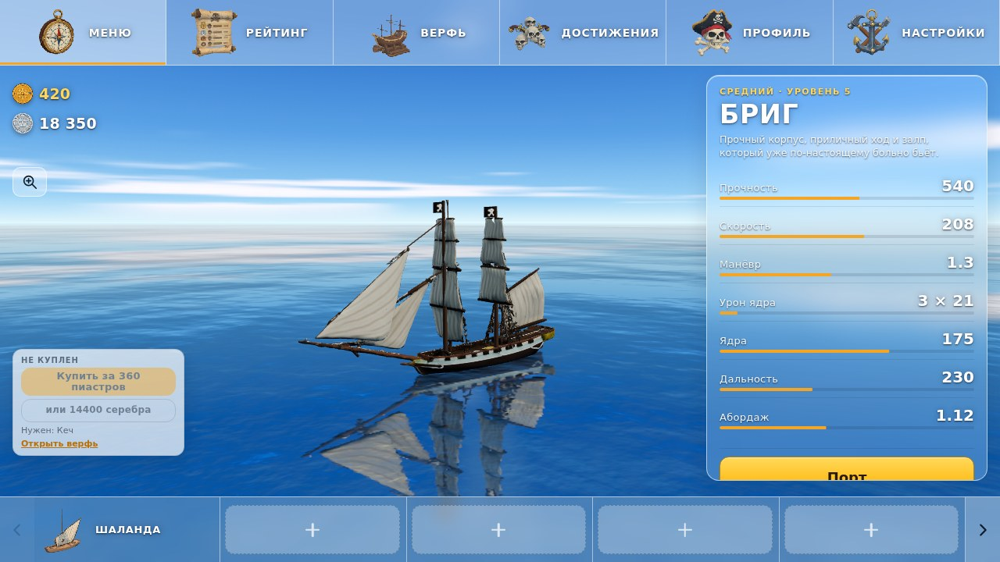
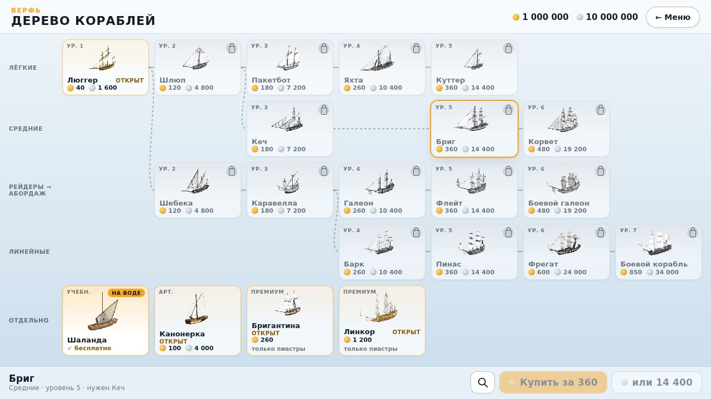

# Pirates Fight

**Онлайн-бои парусных кораблей.** Залпы с борта, абордаж, штурм фортов и захват бухт. Верфь из 22 кораблей,
порт с модулями и ядрами, медали и рейтинг. Бои с живыми капитанами и ботами. Бесплатно, без рекламы.

Сайт: **https://piratesfight.org**

| Бой в проливе | Ангар | Верфь |
|---|---|---|
|  |  |  |

## Скачать

| Платформа | Сборка | Установка |
|---|---|---|
| **Android** | [pirates-fight.apk](https://github.com/piratesfight/pirates-fight-app/releases/latest/download/pirates-fight.apk) | скачать, разрешить установку из этого источника, запустить |
| **iPhone и iPad** | [PiratesFight.ipa](https://github.com/piratesfight/pirates-fight-app/releases/latest/download/PiratesFight.ipa), сборка для тестировщиков | через Sideloadly с вашим Apple ID, работает семь дней; App Store и TestFlight готовятся |

Те же файлы лежат на сайте: [APK](https://piratesfight.org/downloads/pirates-fight-debug.apk), [IPA](https://piratesfight.org/downloads/PiratesFight-unsigned.ipa). Все сборки с датами: [Releases](https://github.com/piratesfight/pirates-fight-app/releases).
Игра обновляется сама: приложение подтягивает новую версию при запуске, переустанавливать ничего не нужно.
Прогресс хранится на сервере, аккаунт можно привязать к Google или паролю и играть с любого устройства.

## Что в игре

- **Залп с борта.** Пушки стоят по бортам: заходите боком и бейте залпом. Автоприцел кладёт залп на корабль или на форт.
  Книпели рвут паруса, зажигательные жгут, тяжёлые пробивают. Абордаж борт о борт, ремонт раз за бой, мины за корму.
- **Три режима, шесть карт.** Потопить всех на Главной 5×5; захват бухты на Забытом маяке 4×4 и в Двух крепостях 3×3;
  штурм фортов в Трёх проходах 4×4, на Серых вершинах 3×3 и в Проливе 3×3. Учебная бухта для новичков.
- **Корабли.** 22 корабля в линиях: лёгкие, средние, рейдеры, тяжёлые, артиллерия и премиум за пиастры. Опыт копится на
  том корабле, на котором воевали, и открывает следующий в линии и его оснастку. Свободный опыт с каждого боя можно
  вложить в любой корабль. Первая победа дня на каждом корабле даёт двойной опыт. Пробные корабли недели.
- **Равные бои.** Команды подбираются равными по силе и стартуют в одинаковых условиях. Читы не работают.
- **Медали и рейтинг.** Двадцать медалей за подвиги, ладдер капитанов, ежедневные задания.

## Требования

- Android 8 и новее, iOS 15 и новее. Хорошее Wi-Fi или 4G.
- 120 кадров в секунду на экранах, которые это умеют.

## Связь

Вопросы, баги и предложения: **Issues** этого репозитория.

---

**Pirates Fight** is a free online naval PvP game: broadside salvos, boarding, fort assaults and bay captures on six maps,
a shipyard of 22 hulls with per-hull experience, medals and a ladder. Android APK and an
unsigned iOS build for testers are linked above; the apps update themselves over the air.
